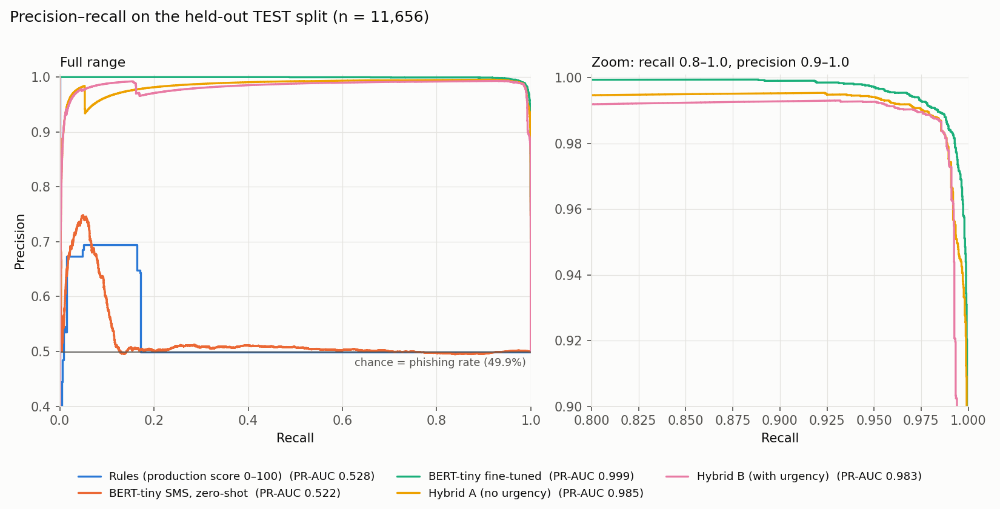

# SentinelAI — e-mail phishing detector evaluation

_Generated by `python eval/run_all.py`. Every number below is read from `reports/results.json`. Seed 42; all models scored on the identical TEST split (sha256 `017b6ebcd95c…`)._

## 1. Dataset

Source: **Phishing Email Curated Datasets** (Champa, Rabbi & Zibran; Zenodo record 8339691, CC-BY-4.0). These are the same six corpora that make up the Kaggle *Phishing Email Dataset*. All six files matched their published MD5 checksums: **True**. Label 1 = phishing **or spam** (the corpora mix both), 0 = legitimate.

| corpus | raw rows | raw phishing | sender column | kept rows | phishing rate (kept) | kept with sender |
|---|---|---|---|---|---|---|
| CEAS_08 | 39,154 | 21,842 | yes | 34,789 | 50.9% | 34,789 |
| Enron | 29,767 | 13,976 | **no** | 29,043 | 46.8% | 0 |
| Ling | 2,859 | 458 | **no** | 2,851 | 16.1% | 0 |
| Nazario | 1,565 | 1,565 | yes | 1,524 | 100.0% | 1,524 |
| Nigerian_Fraud | 3,332 | 3,332 | yes | 3,270 | 100.0% | 2,941 |
| SpamAssasin | 5,809 | 1,718 | yes | 5,775 | 29.2% | 5,775 |

**Cleaning (rows removed):**

| step | rows |
|---|---|
| raw total | 82,486 |
| empty body | 5 |
| exact duplicates (sender+subject+body+label) | 0 |
| same text with conflicting labels | 0 |
| duplicates after case/whitespace normalisation | 596 |
| same body, different subject | 733 |
| template clusters capped at 10 e-mails (largest cluster had 2,930) | 3,900 |
| **kept** | **77,252** |

Why the extra de-duplication: the first random split put 1,657 test e-mails (13.5%) in the same 200-character template as a training e-mail (spam campaigns, newsletters, list digests; one CEAS_08 campaign alone had 2,930 copies). A fine-tuned model would be partly graded on memorised templates. The final split is **stratified on source × label and grouped by template** (first 200 chars of normalised body (StratifiedGroupKFold, 20 folds)), so no template spans splits.

| split | n | phishing | legit | phishing rate | with sender | body has an http(s) URL |
|---|---|---|---|---|---|---|
| train | 54,037 | 26,724 | 27,313 | 49.5% | 31,493 | 36.0% |
| val | 11,559 | 5,676 | 5,883 | 49.1% | 6,729 | 35.9% |
| test | 11,656 | 5,817 | 5,839 | 49.9% | 6,807 | 36.5% |

Leakage checks on the final split: test bodies identical to a train body = **0**; test bodies sharing their first 200 normalised characters with a train body = **0** (val: 0 / 0).

Sender availability: Enron and Ling have no sender column, and some Nigerian_Fraud rows have none. Those rows are kept; production's `analyze_sender('')` returns 0 for them. Metrics are reported overall **and** on the 6,807-e-mail sender-available TEST subset.

**Many URLs are invisible to the rule engine in this release.** In Nazario, most links were stripped from the body, although the dataset's `urls` flag says they existed. Enron and Ling store URLs tokenised with spaces (`http : / / www . x . com`), which production's `extract_urls()` regex cannot match. Production's URL rules can only score `http(s)://` URLs present in the text:

| corpus | flagged as containing URLs | body contains a parseable http(s):// URL | flagged but no URL left in body | body contains a space-tokenised URL |
|---|---|---|---|---|
| CEAS_08 | 67.0% | 67.0% | 0.0% | 0.0% |
| Enron | n/a | 0.0% | n/a | 18.3% |
| Ling | n/a | 0.0% | n/a | 38.5% |
| Nazario | 90.9% | 12.3% | 80.4% | 0.0% |
| Nigerian_Fraud | 34.5% | 32.9% | 1.8% | 0.0% |
| SpamAssasin | 86.1% | 78.7% | 7.5% | 0.0% |

## 2. Results on the held-out TEST split

| model | threshold (chosen by) | precision | recall | F1 | accuracy | ROC-AUC | PR-AUC | latency ms (median / p95) | size MB |
|---|---|---|---|---|---|---|---|---|---|
| Rules (production) — score ≥ 30 (MEDIUM+) ⚠ degenerate: flags almost no e-mail (0.6%) | 30 (fixed (production level)) | 0.394 | 0.004 | 0.009 | 0.500 | 0.540 | 0.528 | 0.36 / 1.67 | 0.03 |
| Rules (production) — score ≥ 70 (HIGH) ⚠ degenerate: flags almost no e-mail (0.0%) | 70 (fixed (production level)) | 0.000 | 0.000 | 0.000 | 0.501 | 0.540 | 0.528 | 0.36 / 1.67 | 0.03 |
| BERT-tiny SMS model, zero-shot (P ≥ 0.5) | 0.5 (fixed (argmax)) | 0.504 | 0.561 | 0.531 | 0.505 | 0.508 | 0.522 | 9.29 / 18.11 | 17.79 |
| BERT-tiny SMS model, zero-shot (VAL threshold) ⚠ degenerate: flags ≈ every e-mail (100.0%) | 0.0617 (VAL max-F1) | 0.499 | 1.000 | 0.666 | 0.499 | 0.508 | 0.522 | 9.29 / 18.11 | 17.79 |
| BERT-tiny fine-tuned on e-mail | 0.445 (VAL max-F1) | 0.984 | 0.990 | 0.987 | 0.987 | 0.999 | 0.999 | 9.58 / 18.02 | 18.49 |
| Hybrid A — url + sender + 40·P | 36 (VAL max-F1) | 0.987 | 0.985 | 0.986 | 0.986 | 0.995 | 0.985 | 10.31 / 21.50 | 18.52 |
| Hybrid B — (url + sender + urgency + 40·P)·100/115 | 31.3 (VAL max-F1) | 0.987 | 0.985 | 0.986 | 0.986 | 0.993 | 0.983 | 10.31 / 21.50 | 18.52 |

n = 11,656 test e-mails (49.9% phishing, so a constant "phishing" classifier would score F1 ≈ 0.666 and ROC-AUC 0.5). ROC-AUC and PR-AUC use each model's continuous score (rules: the 0–100 risk score; BERT: P(phishing)). Latency is per e-mail, batch size 1, CPU (4 torch threads, AMD64 Family 25 Model 68 Stepping 1, AuthenticAMD), after 50 warm-up e-mails, measured on the same 1,000 seeded test e-mails for every approach; BERT timings include tokenisation. Size: rules = `sentinel_ai_v2.py` source; BERT = weights + tokenizer files; hybrid = both.

### Sender-available TEST subset

| model | n | precision | recall | F1 | ROC-AUC |
|---|---|---|---|---|---|
| Rules (production) — score ≥ 30 (MEDIUM+) | 6,807 | 0.394 | 0.007 | 0.014 | 0.542 |
| Rules (production) — score ≥ 70 (HIGH) | 6,807 | 0.000 | 0.000 | 0.000 | 0.542 |
| BERT-tiny SMS model, zero-shot (P ≥ 0.5) | 6,807 | 0.527 | 0.581 | 0.553 | 0.504 |
| BERT-tiny SMS model, zero-shot (VAL threshold) | 6,807 | 0.534 | 1.000 | 0.696 | 0.504 |
| BERT-tiny fine-tuned on e-mail | 6,807 | 0.985 | 0.994 | 0.990 | 0.999 |
| Hybrid A — url + sender + 40·P | 6,807 | 0.985 | 0.992 | 0.989 | 0.993 |
| Hybrid B — (url + sender + urgency + 40·P)·100/115 | 6,807 | 0.985 | 0.992 | 0.988 | 0.991 |

### Confusion matrices (TEST)

**Rules (production) — score ≥ 30 (MEDIUM+) — threshold 30**

| | predicted legit | predicted phishing |
|---|---|---|
| **actual legit** | 5,799 | 40 |
| **actual phishing** | 5,791 | 26 |

**Rules (production) — score ≥ 70 (HIGH) — threshold 70**

| | predicted legit | predicted phishing |
|---|---|---|
| **actual legit** | 5,839 | 0 |
| **actual phishing** | 5,817 | 0 |

**BERT-tiny SMS model, zero-shot (P ≥ 0.5) — threshold 0.5**

| | predicted legit | predicted phishing |
|---|---|---|
| **actual legit** | 2,624 | 3,215 |
| **actual phishing** | 2,554 | 3,263 |

**BERT-tiny SMS model, zero-shot (VAL threshold) — threshold 0.0617**

| | predicted legit | predicted phishing |
|---|---|---|
| **actual legit** | 1 | 5,838 |
| **actual phishing** | 1 | 5,816 |

**BERT-tiny fine-tuned on e-mail — threshold 0.445**

| | predicted legit | predicted phishing |
|---|---|---|
| **actual legit** | 5,747 | 92 |
| **actual phishing** | 60 | 5,757 |

**Hybrid A — url + sender + 40·P — threshold 36**

| | predicted legit | predicted phishing |
|---|---|---|
| **actual legit** | 5,763 | 76 |
| **actual phishing** | 87 | 5,730 |

**Hybrid B — (url + sender + urgency + 40·P)·100/115 — threshold 31.3**

| | predicted legit | predicted phishing |
|---|---|---|
| **actual legit** | 5,761 | 78 |
| **actual phishing** | 86 | 5,731 |

### Precision–recall curves



## 3. Experiment details

### 3.1 Rule engine (production `sentinel_ai_v2.py`)

The rules are imported, not re-implemented. Per e-mail the harness repeats `run_scanner()` exactly: URLs are taken from the body only, each URL's `url_heuristic_score` is **summed**, then `sender_heuristic_score` and `urgency_heuristic_score(subject + " " + body)` are added, and `calculate_risk(..., features=None)` gives url ≤ 35 + sender ≤ 25 + urgency ≤ 15. No `model.pkl` exists, so production takes the same heuristic path.

| TEST diagnostic | legit | phishing |
|---|---|---|
| e-mails with ≥1 URL extracted | 38.1% | 34.8% |
| rule score exactly 0 | 90.5% | 82.9% |
| level MEDIUM RISK | 40 | 26 |
| level HIGH RISK | 0 | 0 |
| sender domain in TRUSTED_DOMAINS | 399 | 43 |
| mean url_risk / sender_risk / urgency | 0.44 / 0.14 / 0.57 | 0.26 / 0.45 / 1.39 |

Reproducibility patch: production calls `tldextract.extract`, which downloads the live Public Suffix List. The harness points the same library at its bundled snapshot instead. No rule changes. One-off parity check (`python eval/eval_rules.py --check-psl-parity`): **0 of 11,656** test scores differ between snapshot and live list.

Rules ≥ 30, per source (TEST):

| source | n | precision | recall | F1 | ROC-AUC |
|---|---|---|---|---|---|
| CEAS_08 | 5,284 | 0.025 | 0.000 | 0.001 | 0.489 |
| Enron | 4,367 | 0.000 | 0.000 | 0.000 | 0.518 |
| Ling | 423 | 0.000 | 0.000 | 0.000 | 0.624 |
| Nazario | 227 | 1.000 | 0.004 | 0.009 | n/a |
| Nigerian_Fraud | 494 | 1.000 | 0.010 | 0.020 | n/a |
| SpamAssasin | 861 | 0.950 | 0.074 | 0.138 | 0.649 |

### 3.2 Pretrained BERT-tiny, zero-shot (SMS → e-mail domain shift)

`mrm8488/bert-tiny-finetuned-sms-spam-detection` @ `012e2681d9`, input = subject + body truncated to 128 tokens. The model card does not state which label is spam, so it was checked on four SMS probes (card widget + UCI-style texts): P(LABEL_1) = 0.90, 0.91, 0.06, 0.06 for labels [1, 1, 0, 0]. **LABEL_1 = spam**, mapped to phishing.

- TEST ROC-AUC **0.508**: the model's score barely separates the classes on e-mail. Test probabilities span only [0.062, 0.911].
- Re-picking the threshold on VAL (0.062) flags almost every e-mail as phishing. Its F1 matches the constant classifier, which reflects the class balance, not skill.
- 64.4% of test e-mails are longer than 128 tokens, so the model sees only their opening.

Why it fails: the checkpoint was trained on the 2012 UCI SMS corpus (~5.5k short texts). There, spam means premium-rate numbers, "WINNER!! claim £900" and txt-speak, and ham means short personal chat. E-mail is long-form, has headers, signatures, HTML remnants, mailing-list footers and newsletters, and its phishing uses account-verification and invoice lures, not prize SMS. Inputs are also far longer than anything seen in training. The features the SMS model learned don't carry over, which matches the near-chance ranking.

### 3.3 Fine-tuned BERT-tiny

Same checkpoint, fine-tuned on the TRAIN split only. Hyper-parameters were fixed before training, not searched: max_len 256, 4 epochs, batch 32, AdamW lr 0.0001, weight decay 0.01, linear warm-up 6% then linear decay, grad-clip 1.0, seed 42, 4 CPU threads, deterministic torch algorithms. Epoch picked by **lowest VAL loss** → epoch **3**; threshold by max VAL F1 → **0.445**. TEST was scored once.

| epoch | train loss | val loss | val F1 @0.5 | val ROC-AUC | seconds |
|---|---|---|---|---|---|
| 0 | n/a | 0.9695 | n/a | n/a | – |
| 1 | 0.173 | 0.0545 | 0.984 | 0.999 | 1206 |
| 2 | 0.043 | 0.0503 | 0.987 | 0.999 | 1048 |
| 3 | 0.020 | 0.0489 | 0.989 | 0.999 | 968 |
| 4 | 0.012 | 0.0525 | 0.989 | 0.999 | 969 |

At the default 0.5 threshold, TEST F1 = 0.987.

Per source (TEST):

| source | n | precision | recall | F1 | ROC-AUC |
|---|---|---|---|---|---|
| CEAS_08 | 5,284 | 0.988 | 0.997 | 0.992 | 1.000 |
| Enron | 4,367 | 0.984 | 0.984 | 0.984 | 0.999 |
| Ling | 423 | 0.913 | 0.926 | 0.920 | 0.997 |
| Nazario | 227 | 1.000 | 0.978 | 0.989 | n/a |
| Nigerian_Fraud | 494 | 1.000 | 0.996 | 0.998 | n/a |
| SpamAssasin | 861 | 0.925 | 0.969 | 0.947 | 0.993 |

### 3.4 Hybrid

- **hybrid_A_url_sender_bert**: VAL-chosen threshold 35.96; TEST F1 0.986, ROC-AUC 0.995.
- **hybrid_B_rescaled_with_urgency**: VAL-chosen threshold 31.27; TEST F1 0.986, ROC-AUC 0.993.

For comparison, the fine-tuned model alone: TEST F1 0.987, ROC-AUC 0.999. The rule components rarely fire on this data (§3.1), so in practice the hybrid score is mostly 40·P.

## 4. Error analysis

Best model by **VAL** F1 (chosen without looking at test): **BERT-tiny fine-tuned on e-mail** (VAL F1 0.989). On TEST it makes 92 false positives and 60 false negatives. `reports/errors.csv` holds the 20 most confident FPs (highest score) and 20 most confident FNs (lowest score) on TEST.

| source | test n | errors | error rate | FP | FN |
|---|---|---|---|---|---|
| CEAS_08 | 5,284 | 41 | 0.8% | 34 | 7 |
| Enron | 4,367 | 65 | 1.5% | 32 | 33 |
| Ling | 423 | 11 | 2.6% | 6 | 5 |
| Nazario | 227 | 5 | 2.2% | 0 | 5 |
| Nigerian_Fraud | 494 | 2 | 0.4% | 0 | 2 |
| SpamAssasin | 861 | 28 | 3.3% | 20 | 8 |

Median body length: 152 words for errors vs 125 for correct predictions. Share with an extracted URL: 28.3% of errors vs 36.4% overall. Share with a sender: 50.0% of errors vs 58.4% overall.

**Patterns in the 20 most confident false positives** (legitimate mail scored P ≈ 1.0):

- **Legitimate bulk and commercial mail.** A real Frito-Lay sweepstakes prize notice, Ektron CMS marketing, a CNN Breaking News alert, an AOL Instant Messenger welcome mail and a delivery-failure bounce. They share vocabulary with spam ("Congratulations", "free", "you've won", newsletter boilerplate). The CNN alert also resembles the large spoofed-CNN spam campaign in CEAS_08. Some of these are arguably bulk mail the recipient didn't want, so the "ham" label is debatable.
- **Long forwarded articles on mailing lists.** FoRK-list forwards of BBC, Bollywood and EPA news stories: long, impersonal, no personal context. The model sees no personal signal and leans towards spam.
- **Very short or data-only Enron mails.** A body that is only a URL, or credential lists containing "user id password". The model has almost nothing to go on, and "password" plus a URL are strong phishing cues.

**Patterns in the 20 most confident false negatives** (phishing/spam scored P ≈ 0):

- **Spam that reads like professional mail.** Conference and workshop invitations, chemistry-supplier and industrial-Linux promotions, written in the same register as Enron business mail.
- **Lures with little or no text.** "The file is protected with the password ghj001.", "xJDEHIX Thanks!", and a Nazario phishing body that is only HTML image-map markup. The payload is in an attachment or image the dataset doesn't include, so no text model can catch these. Production would need attachment and HTML analysis.
- **Filter-evasion text.** Word-salad paragraphs and quote collections ("luck is the residue of design…") inserted to dilute spam vocabulary.
- **Label noise.** An academic reply about using the Ling-Spam corpus for discourse analysis is labelled spam, and a SpamAssassin-quarantined message carries the scanner's own report text.

**Takeaways.** Many residual errors sit where the label itself is ambiguous (legitimate bulk mail versus spam), or where the content signal lives outside the text (attachments, images). These are limits of the data and of text-only input, so they don't argue for a bigger text model. Adding sender authentication (SPF/DKIM/DMARC), attachment type and HTML-link analysis is the logical next step. Note that the error rate is highest in SpamAssassin and Ling (§4 table), and that Enron accounts for the largest share of errors (65 of 152).

## 5. Are the high scores real? (leakage and shortcut checks)

1. **Exact / template leakage:** 0 test e-mails share a body or a 200-character prefix with a train e-mail (§1).
2. **Fuzzy near-duplicates** (TF-IDF cosine to the nearest TRAIN e-mail): 9.8% of TEST e-mails have a train neighbour with cosine ≥ 0.95, 15.4% ≥ 0.9, 27.7% ≥ 0.8 (median 0.61). The fine-tuned model on test e-mails **without** a close train neighbour (cosine < 0.8, n = 8,430): F1 0.983, ROC-AUC 0.999. On those **with** one (n = 3,226): F1 0.997, ROC-AUC 1.000.
3. **Bag-of-words reference:** TF-IDF + logistic regression on the same split (threshold on VAL) scores TEST F1 0.988, ROC-AUC 0.999. This benchmark is close to linearly separable on word counts, so a high F1 here says more about the dataset than about model capacity.
4. **Corpus identification:** TF-IDF + logistic regression predicts the *source corpus* of a TEST e-mail with 95.3% accuracy (majority class 45.3%). Corpora are highly distinguishable, and two of them contain only phishing, so part of any learned model's score can come from recognising the corpus.

Most influential phishing tokens (reference model): `your`, `you`, `2004`, `2005`, `love`, `monkey`, `our`, `remove`, `jose`, `life`, `site`, `money`, `account`, `here`, `sightings`, `com`, `livefilestore`, `watches`, `investment`, `her`

Most influential legitimate tokens: `enron`, `wrote`, `thanks`, `the`, `2008`, `vince`, `louise`, `opensuse`, `on`, `university`, `nz`, `fork`, `2007`, `713`, `tony`, `rant`, `python`, `edu`, `newsisfree`, `doc`

Conclusion: no duplicate leakage remains, but the benchmark is easy and corpus-specific vocabulary is predictive. Treat the fine-tuned F1 as *in-distribution performance on 1999–2008 corpora*, not as expected performance on a modern inbox.

## 6. Limitations

- **Dataset age.** The corpora date from roughly 1999–2008 (Enron, SpamAssassin, Ling, CEAS 2008, Nazario, Nigerian fraud). Modern lures (MFA fatigue, QR codes, OAuth-consent, invoice/BEC, LLM-written text, `.xyz/.top` throw-away domains) are under-represented. Metrics here do not predict performance on a 2026 inbox.
- **Spam ≠ phishing.** Label 1 mixes generic spam (Enron, SpamAssassin, Ling, most of CEAS) with phishing and 419 fraud (Nazario, Nigerian_Fraud). A good spam score is not proof of phishing-specific skill.
- **Source confounding.** Nazario and Nigerian_Fraud contain only positives, and Enron/Ling have no sender. A learned model can partly identify the *corpus* rather than the attack. The per-source tables show where performance comes from.
- **TRUSTED_DOMAINS bias.** The rule engine's allow-list (gmail.com, google.com, naukri.com, canarabank.com, reddit.com, snapchat.com, …) is tuned to one personal inbox. On TEST, 399 legitimate and 43 phishing senders hit it. A free-mail domain like gmail.com is trusted outright, so phishing from any Gmail account gets sender risk 0.
- **URLs invisible to the rules.** This release stripped most Nazario links and stores Enron/Ling URLs space-tokenised, starving the URL component (35 of 100 points). Production reads raw Gmail bodies with links intact, so the URL rules see more there. These rule numbers are a pessimistic bound for the URL component, not a production estimate.
- **No headers.** No SPF/DKIM/DMARC or Received headers are available, so `analyze_authentication` could not be evaluated.
- **English-only; no Indian-context e-mail.** No UPI/KYC/Aadhaar/PAN, Hindi/Hinglish, or Indian-bank lures, although the scanner's allow-list and brands target an Indian inbox.
- **Small model, short context.** BERT-tiny (2 layers, 128 hidden) sees ≤ 256 tokens (≤ 128 zero-shot). Long e-mails are judged on their opening only. No hyper-parameter search was run, by design, to keep test untouched.
- **One split, one seed.** No confidence intervals or cross-validation. Differences of a few tenths of a point between models are within noise.
- **Thresholds.** VAL-tuned thresholds are optimal for a ~50 % phishing rate. Real inboxes have far fewer phishing e-mails, so precision would drop at the same threshold.

## 7. Reproduce

```
pip install -r requirements-eval.txt
python eval/run_all.py          # data → split → 4 experiments → diagnostics → report
python eval/eval_rules.py --check-psl-parity   # optional, needs network
```

Environment of this run: Python 3.11.9, torch 2.3.1+cpu, transformers 4.41.2, scikit-learn 1.5.0, tldextract 5.1.2, Windows-10-10.0.26200-SP0. Repo commit `8f382d136e`; `sentinel_ai_v2.py` sha256 `16da58d8c59c…` (**with uncommitted changes**).
